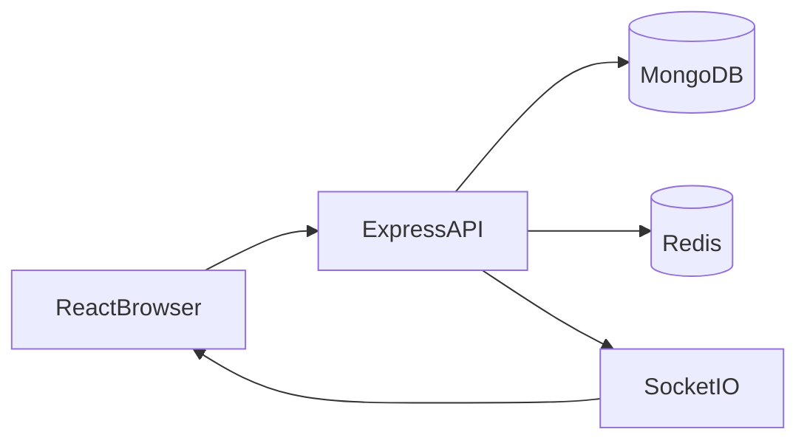
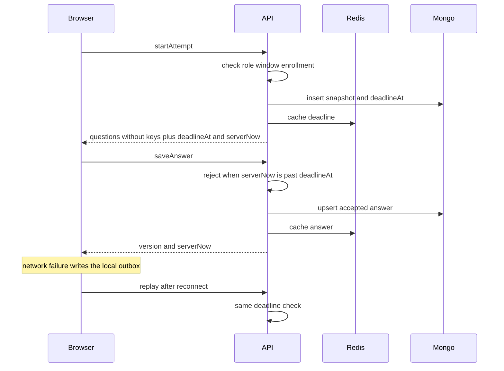

# Holdfast — Architecture

MERN, plus Redis and Socket.IO. TanStack Query holds server state. TanStack Router holds the URL. The attempt outbox is the only client write buffer.

MongoDB is the record. Redis is a cache and a lock. If Redis has no entry for an attempt, reads fall back to Mongo and the cache is refilled. Accepted answers are written to Mongo on every successful save, not only at submit.

## Backend layout

Existing folders in `backend/src` stay. Domain code lands in them.

- `config/` environment
- `models/` Mongoose models
- `services/` marking, deadlines, fair papers, attempts, exams, reports
- `controllers/` HTTP adapters
- `routes/` routers mounted under `/api`
- `validators/` Zod schemas
- `middleware/` auth, errors, validation
- `sockets/` rooms and connection auth
- `jobs/` expiry sweep
- `utils/` logger, async handler, csv parse

`queues/` and `search/` stay unused. The brief does not need a job broker or a search engine, and adding them would be a placeholder.

## Client layout

- `router/` route tree and role guards
- `layouts/` dashboard shell and exam shell
- `pages/` one screen per workflow
- `components/` buttons, fields, banners
- `hooks/` session, attempt runner, preferences
- `lib/` API client, query client, outbox, socket
- `styles/globals.css` the visual system

The dev server proxies `/api` and `/socket.io` to port 3000. The session cookie is `httpOnly`, `sameSite: lax`, and is not `Secure` in local HTTP. Calling the API on another origin from the browser would drop that cookie, so the client uses same-origin `/api`.

## Collections

**User.** `name`, `email` (unique, lowercase), `passwordHash`, `role` (`admin | examiner | candidate`), `active`.

**Question.** `stem`, `type` (`single | multi | written`), `choices[]` of `{ id, text }`, `correctChoiceIds[]`, `marks`, `category`, `difficulty`, `weight` (1, 2, or 3), `authorId`.

**Exam.** `title`, `instructions`, `windowStart`, `windowEnd`, `durationMinutes`, `totalMarks`, `examinerId`, `publication` (`draft | published`), `resultsPublished`, `settings`:

- `randomizeQuestions`, `randomizeChoices`
- `fairPaper`, `questionCount`, `difficultyBudget`, `tolerance`
- `multiSelectRule` fixed to `partial` for this version

Display lifecycle is computed. It is not stored, so the clock cannot drift from a stale status field.

**ExamQuestion.** `examId`, `questionId`, `marks`, `pinned`, `order`. Unique on `(examId, questionId)`.

**Enrollment.** `examId`, `candidateId`. Unique pair.

**Attempt.** `examId`, `candidateId`, `isSandbox`, `startedAt`, `deadlineAt`, `submittedAt`, `status` (`in_progress | submitted | expired | graded`), `gradingStatus` (`pending_subjective | ready`), `questionSnapshots[]`, `objectiveScore`, `writtenScore`, `totalScore`.

A snapshot item stores `questionId`, `order`, `stem`, `type`, `choices`, `correctChoiceIds`, `marks`, `category`, `difficulty`, `weight`.

Unique index on `(examId, candidateId)` where `isSandbox` is false. One real sitting per candidate per exam. Sandbox attempts are unlimited.

**Answer.** `attemptId`, `questionId`, `choiceIds`, `text`, `flaggedForReview`, `savedAt`, `version`. Unique on `(attemptId, questionId)`.

**Incident.** `attemptId`, `examId`, `type`, `at`, `note`, `conclusive` always false.

**Announcement.** `examId`, `body`, `createdAt`, `authorId`.

**Grade.** `attemptId`, `questionId`, `awardedMarks`, `comment`, `graderId`. Unique on `(attemptId, questionId)`.

**WorkspacePreference.** `userId` unique, `fontScale`, `contrast` (`default | high`), `navigator` (`side | bottom`).

**Scratchpad.** `attemptId` unique, `text`, `updatedAt`.

**ReportVerification.** `attemptId` unique, `codeHash`, `issuedAt`, `revoked`.

## Attempt engine

Start rules:

- Candidate: enrolled, published, server now inside the window, no finalized real attempt. An `in_progress` attempt is returned as-is.
- Examiner sandbox: must own the exam. Allowed in draft or published. `deadlineAt = startedAt + duration`. `isSandbox: true`.

`deadlineAt` for a real attempt is `min(startedAt + durationMinutes, windowEnd)`.

Save rules:

- Caller must own the attempt (the candidate, or the examiner who started that sandbox).
- Status must be `in_progress`.
- `serverNow <= deadlineAt`.
- Choice ids must belong to the snapshot. Written answers are text only.
- Version increments by one.

Submit and expiry share one finalizer. A Redis lock (`SET NX`) plus a status check makes the second call idempotent. Objective scores are written in that transaction. If any snapshot question is `written` and has no grade, `gradingStatus` is `pending_subjective` and `status` is `submitted` or `expired`. If there is no written question, `gradingStatus` is `ready` and `status` is `graded`.

A sweep every 15 seconds finalizes `in_progress` attempts whose `deadlineAt` has passed, so a candidate who closes the laptop still gets finished.

Heartbeat returns `serverNow`, `deadlineAt`, and presence. It does not move the deadline. If the deadline has passed, the heartbeat finalizes and says so.

## Fair paper generator

Weights: easy 1, medium 2, hard 3.

When `settings.fairPaper` is false, the paper is every assigned question, optionally shuffled.

When it is true:

1. Split assignment rows into pinned and pool.
2. Let `need = questionCount - pinned.length`. If `questionCount` is missing, `need` is the whole pool.
3. Draw up to 40 samples of size `need`. Each sample walks categories in round-robin and picks a remaining question, with a slight bias toward the weight that reduces distance to `difficultyBudget`.
4. Keep the sample with the smallest `|sum(weights) - budget|`. Prefer a sample that uses more distinct categories when the distance is equal.
5. Concatenate pinned questions and the sample. Shuffle the full list only when `randomizeQuestions` is on. Shuffle choices when `randomizeChoices` is on.

Preview (`POST /api/exams/:id/preview-papers`) runs the generator twice and returns stems, categories, difficulties, and weight totals. It does not create attempts. That is the 5.2 demo surface.

## Serializers

`toCandidateAttempt` drops `correctChoiceIds` from every snapshot and omits grades until `resultsPublished` is true. `toExaminerAttempt` includes the key and is only used after the caller passes the ownership check. PDF generation uses the examiner shape on the server and never sends the key to the public verify route.

The verify response is `{ examTitle, totalScore, totalMarks, issuedAt, status }`.

## HTTP surface

- `POST /api/auth/login`, `POST /api/auth/logout`, `GET /api/auth/me`
- `GET|POST /api/users`, `PATCH /api/users/:id` — admin
- `GET|POST /api/questions`, `GET|PATCH|DELETE /api/questions/:id` — examiner
- `POST /api/questions/import`, `POST /api/candidates/import`
- `GET|POST /api/exams`, `GET|PATCH /api/exams/:id`, `POST /api/exams/:id/publish`
- `POST|DELETE /api/exams/:id/questions`, assignment
- `POST|DELETE /api/exams/:id/enrollments`
- `POST /api/exams/:id/attempts` start or resume
- `POST /api/exams/:id/sandbox`
- `POST /api/exams/:id/preview-papers`
- `GET /api/attempts/:id`, `PUT /api/attempts/:id/answers`, `POST /api/attempts/:id/submit`, `POST /api/attempts/:id/heartbeat`, `PUT /api/attempts/:id/scratchpad`, `POST /api/attempts/:id/incidents`
- `GET /api/exams/:id/monitoring`, `GET /api/exams/:id/incidents`, `POST /api/exams/:id/announcements`
- `GET /api/exams/:id/grading`, `PUT /api/grading/:attemptId/questions/:questionId`, `POST /api/exams/:id/publish-results`
- `GET /api/results/me`, `GET /api/results/:attemptId`
- `GET /api/exams/:id/analytics`, `GET /api/exams/:id/question-analytics`
- `GET /api/reports/:attemptId/pdf`, `GET /api/verify/:code`
- `GET|PUT /api/preferences`

Cookie name: `holdfast_session`. JWT payload: `sub`, `role`. Expiry: 8 hours, so a demo sitting does not die mid-evaluation. The password hash and the JWT secret never appear in responses.

## Sockets

Handshake reads the same cookie. Rooms:

- `exam:{examId}` for announcements and roster pings
- `attempt:{attemptId}` for save acknowledgements

Joining a room re-checks ownership. Disconnect records an incident for a candidate attempt that is still `in_progress`. REST saves still succeed if the socket is down.

## Client runner

On load, the runner fetches the attempt and sets `serverOffset = serverNow - Date.now()`. The visible clock uses that offset. A 15-second heartbeat replaces the offset.

Edits debounce 500ms and call `PUT /answers`. On network failure the mutation is appended to `localStorage` under `holdfast-outbox:{attemptId}`. `online` and a successful heartbeat flush the queue. Palette state reads the optimistic local answer first, then the server answer.

Preferences set `data-contrast` and `data-font` on the runner element. Palette position is a layout class.

## Security notes worth saying out loud

- bcrypt with a cost of 12
- helmet and JSON body limit
- Zod on every write
- exam queries always include `examinerId` unless the caller is an admin
- candidate result queries always include `candidateId` and `resultsPublished: true`
- verification stores `sha256(code)`, not the code; the code is shown once on the result and printed on the PDF
- CORS origin is the single configured client origin, with credentials

## Local processes

`docker-compose.yml` runs MongoDB and Redis only. The API and the Vite app run on the host so reload stays fast. Nothing in the feature set calls a paid service.
